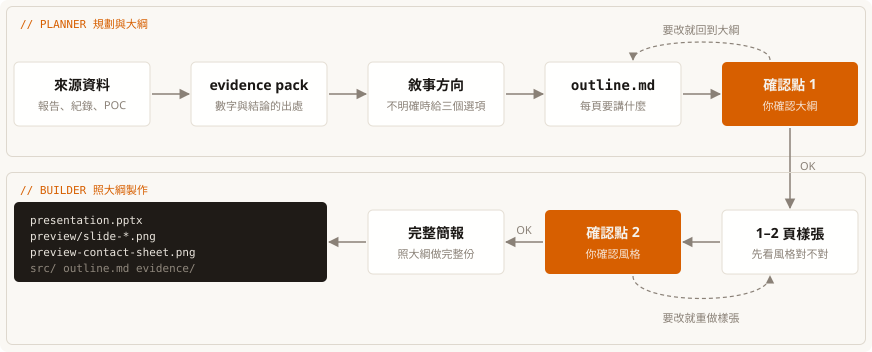
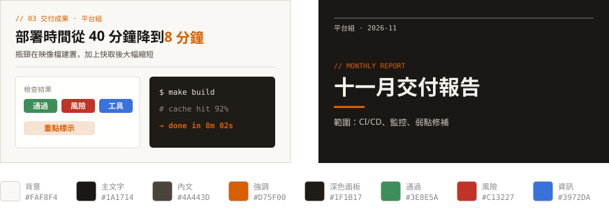
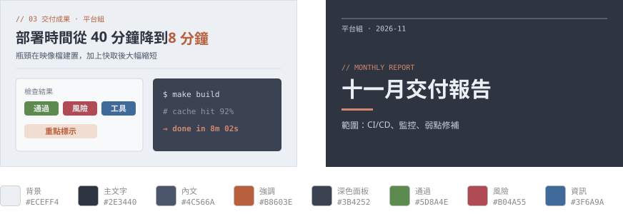
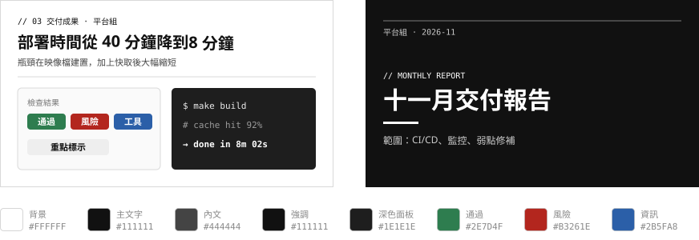

# make-ppt

把月報、技術分享、POC 結果、弱點改善紀錄這類專案資料，整理成一份可以直接在 PowerPoint 裡改的簡報。它是一個 Agent Skill，可以裝在 Codex、Claude Code、Kiro、GitHub Copilot 和 Google Antigravity。

簡報上的每個數字和結論都要對得回來源檔案。除了 `.pptx`，它還會留下大綱、證據紀錄、產生簡報的 Python 程式和逐頁預覽圖，下次要改內容不用從頭做。

## 快速開始

需要 Python 3.9 以上。

```powershell
git clone https://github.com/Ding522/make-ppt.git
cd make-ppt

python .\install.py --client codex --scope user --dry-run   # 先看會裝到哪裡
python .\install.py --client codex --scope user
python .\doctor.py --client codex --scope user              # 檢查環境
```

`codex` 可以換成 `claude`、`kiro`、`copilot`、`antigravity`，或用 `all` 一次裝全部。

裝好後，到放資料的專案目錄直接講需求就可以：

```text
使用 make-ppt，把這個資料夾的素材整理成 10 頁、給工程主管看的技術簡報。重點放在這季交付了什麼，最後提下一階段需要的人力。
```

有些 client 也支援 `/make-ppt` 或 `$make-ppt`，但用一般句子呼叫就行，不依賴特定指令。

## 做一份簡報的流程

不會一開口就產出整份簡報，中間會停兩次（橘色框）讓你確認，確認過才往下做：



`presentation/outline.md` 是整份簡報的依據。Planner 負責證據、敘事和大綱，Builder 只照核准過的大綱做，不會自己改論點、證據或順序；就算兩個角色是同一個 agent 跑的也一樣。

產出會放在 `presentation/`：

```text
presentation/
├── narrative-forks.md          # 方向不明或 explore 模式才有
├── outline.md                  # 大綱
├── edit-impact.md              # 修改既有簡報、且不是小修改時才有
├── evidence/                   # manifest.md、manifest.json、sources/*.md
├── presentation.pptx
├── src/                        # 產生簡報的程式
├── preview/slide-01.png ...
└── preview-contact-sheet.png
```

原始資料不會被覆寫。

## 配色

每份簡報只用一套配色，在大綱確認時決定（記在 `outline.md` 的 `Palette`）。Planner 會依簡報類型建議一套，你也可以直接指定。

### `warm-editorial`：暖米棕（預設）

適合技術分享、導入經驗、案例研究、專案回顧。



### `nord-slate`：灰藍

以 Nord 色系為基礎，適合架構說明、雲端／資安、技術規格。



### `mono-print`：黑白

適合正式文件、會印出來或灰階輸出的報告、稽核報告。這套沒有彩色強調色，重點靠字重和線條。



色值定義在 [`theme.py`](skill/make-ppt/assets/src-template/theme.py) 的 `PALETTES`。改了色值之後，執行 `python docs\images\palettes\generate.py` 重新產生上面的預覽圖。

封面有兩種：技術分享類預設用淺色的 `editorial-light`，月報、進度報告、給主管看的狀態報告預設用深色的 `report-dark`（上圖右側就是 `report-dark` 的樣子）。

## 其他功能

- 輸出的是一般的 PowerPoint 物件（文字框、表格、圖形），不是貼整頁圖片，拿到後可以自己改。
- 內建 timeline、status matrix 等版面，用來畫流程、時程和狀態對照。
- 修改既有簡報時，會先判斷影響範圍；小修改只動相關頁面，不會整份重做。
- 會檢查台灣繁體中文用語。像「配置」這種要看上下文的詞只會列出來給你看，不會自動替換。

## 確認點與成本模式

| 模式 | 什麼時候用 | 行為 |
|---|---|---|
| `standard` | 預設 | 方向清楚就直接規劃；不清楚時先給三個簡短的敘事方向。 |
| `explore` | 想比較不同講法 | 就算需求很清楚，也先比較三種敘事方向。只比方向，不會做三份簡報。 |
| `strict` | 明確說要省成本或趕時間 | 不主動提其他方向，資訊不夠時直接問。 |

三種模式都會停在大綱和樣張這兩個確認點。改敘事方向、新增／刪除／重排主要章節、新增或刪除投影片，都要重新確認大綱；只改文字或不影響結構的視覺微調則不用。SKILL 裡對應的原文是：

```text
Narrative changes, major-section additions/removals/reordering, or slide
additions/removals invalidate prior approval.
```

細節見 [`cost-control-workflow.md`](skill/make-ppt/references/cost-control-workflow.md)。

## 安裝與更新

| Client | User scope | Project scope |
|---|---|---|
| Codex | `~/.agents/skills/make-ppt` | `.agents/skills/make-ppt` |
| Claude Code | `~/.claude/skills/make-ppt` | `.claude/skills/make-ppt` |
| Kiro | `~/.kiro/skills/make-ppt` | `.kiro/skills/make-ppt` |
| GitHub Copilot | `~/.copilot/skills/make-ppt` | `.github/skills/make-ppt` |
| Google Antigravity | `~/.gemini/config/skills/make-ppt` | `.agents/skills/make-ppt` |

安裝時也會順便產生各 client 用的 Planner 和 Builder agent 檔。各 client 的路徑、格式和舊版位置都登記在 [`integrations/clients.json`](integrations/clients.json)。

```powershell
# 裝到所有 client
python .\install.py --client all --scope user

# 裝到某個專案
python .\install.py --client all --scope project --project-dir C:\path\to\project

# 覆蓋更新
python .\install.py --client all --scope user --force

# 連同 Python 套件一起裝（預設不會裝）
python .\install.py --client all --scope user --install-python-deps

# 檢查
python .\doctor.py --client all --scope user
```

要搬移舊版安裝，先用 `--dry-run --migrate-legacy` 看會動到什麼，再用 `--force --migrate-legacy` 執行。舊的安裝不會被默默刪掉。

## 產生預覽圖需要什麼

Python 套件列在 [`requirements.txt`](skill/make-ppt/requirements.txt)。預覽圖的渲染方式：

- Windows：優先用 Microsoft PowerPoint。
- macOS：Microsoft PowerPoint，再用 Poppler 轉圖。
- 都沒有的話：LibreOffice + Poppler。

`doctor.py` 會告訴你哪些有裝、哪些缺：

```powershell
python .\doctor.py --client all --scope user
python .\doctor.py --client antigravity --scope project --project-dir C:\path\to\project
```

## 開發

```text
make-ppt/
├── skill/make-ppt/          # skill 本體，要改就改這裡
│   ├── SKILL.md
│   ├── assets/src-template/ # theme、primitives、版面元件
│   ├── references/          # Planner、Builder、風格與品質規則
│   ├── scripts/             # evidence、渲染、用語檢查、驗證
│   └── templates/           # outline、敘事方向、edit impact 範本
├── integrations/            # 各 client 的設定與 agent metadata
├── docs/                    # README 圖片與 agent 協作文件
├── tests/
├── install.py
├── doctor.py
└── client_registry.py
```

幾個要注意的地方：

- 改 skill 只改 `skill/make-ppt/`；client 之間的差異只改 `integrations/` 和 `integrations/clients.json`。
- 不要直接改 `~/.agents/skills`、`~/.codex/agents` 這類安裝出去的檔案，改完來源後重跑 `install.py --force`。
- 不要把安裝副本、備份、預覽圖、測試輸出或整個 `presentation/` 複製回 repo。commit 前看一下 `git status`。

跑測試：

```powershell
python -m unittest discover -s tests -v
```

檢查用語（高信心的用語問題會讓檢查失敗，需要看上下文的只列出來）：

```powershell
python .\skill\make-ppt\scripts\lint_zh_tw.py presentation\outline.md --outline-visible-only
python .\skill\make-ppt\scripts\lint_zh_tw.py presentation\presentation.pptx
```

## 延伸閱讀

- [SKILL.md](skill/make-ppt/SKILL.md)
- [Planner 角色](skill/make-ppt/references/ppt-planner-role.md)
- [Builder 角色](skill/make-ppt/references/ppt-builder-role.md)
- [Style guide](skill/make-ppt/references/style-guide.md)
- [資訊視覺化](skill/make-ppt/references/information-visualization.md)
- [關係型版面](skill/make-ppt/references/relationship-layouts.md)
- [PPTX 產生規則](skill/make-ppt/references/pptx-generation-rules.md)
